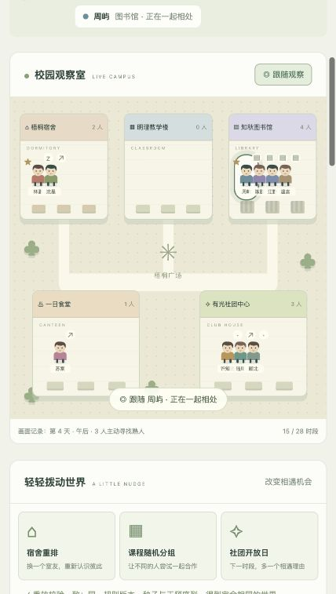

# VirtualCampus · 赛博校园

> 十个独立的小世界，在同一座校园慢慢交织。

一个校园背景的半上帝模式微型生命模拟器。观察 10 位 NPC 自主上课、吃饭、休息与社交，通过改变环境影响相遇，围观友情、暗恋、误解与竞争自然形成。

**当前为 v0.2 校园观察版。** 无需大模型 API 密钥，无运行时依赖，纯本地运行。已加入动态校园、人物关注、双向观察的关系图、主动邀约与回避，以及可校验的本机存档。



## 开始玩

下载或克隆后，用浏览器直接打开 `index.html`。也可以使用 Node.js 22+：

```sh
git clone https://github.com/L8848-Li/VirtualCampus.git
cd VirtualCampus
npm run dev
```

打开 http://127.0.0.1:8765 。无需 `npm install`，无后端服务。端口被占用时：`PORT=8766 npm run dev`。

## 如何观察

1. 输入种子，新建一个校园世界。
2. 选择「下一时段」，或「继续」并调节速度。
3. 点击小人，查看性格、需求、目标、关系和有限记忆。
4. 在档案点 ☆ 关注最多三人，开启跟随观察，切换关系图的两种视角。
5. 重排宿舍、课程随机分组，或举办社团开放日。
6. 阅读事件、查看评分与因果链，日终在校园墙回看重要片段。
7. 七天结束后「重放」，验证相同种子与干预能产生相同结果。

每次推进与干预都会自动保存在当前浏览器，刷新后暂停恢复。导出 / 导入 JSON 可留存或转移世界；存档导入会重新运行并校验。当前引擎版本不兼容 v0.1 存档。

## 当前能力

| 部分     | 已实现                                                           |
| -------- | ---------------------------------------------------------------- |
| 校园     | 宿舍、教学楼、食堂、图书馆、社团中心                             |
| 时间     | 7 天 × 4 时段，单步、暂停、继续与加速                            |
| 角色     | 10 人，性格、需求、固定目标、单向关系、按显著性保留 8 条亲历记忆 |
| 决策     | 需求、兴趣、习惯与关系共同评分，局部目击与同地点互动             |
| 故事     | 主动寻找、邀约、接受、婉拒、擦肩、误解、澄清、竞争与心动         |
| 干预     | 宿舍重排、课程分组、下一时段社团活动                             |
| 可解释性 | 行动评分、规则原因、数值变化、前置事件追溯                       |
| 可复现   | 种子 PRNG、带时段的干预记录、同版本重放校验                      |

## 开发

```sh
npm run check
npm test
```

`npm test` 对 100 个种子的七日周期逐步校验重放、需求边界、地点合法性、记忆限制、因果图与终止行为，并覆盖关系驱动的行动、邀约与拒绝、过时信息、存档往返和无效输入。GitHub Actions 对 Node.js 22 / 24 运行相同检查。

```text
index.html                 页面入口
src/engine.js              世界推进、事件、记忆与存档
src/sim/                   角色配置、随机数、决策与社交
src/ui/                    地图表现与观察视图
src/app.js                  控制、界面、导出与因果弹窗
src/style.css               地图与响应式样式
scripts/dev-server.cjs     本地开发入口
tests/                     确定性、行为与存档回归检查
docs/ARCHITECTURE.md        底层算法与模块边界
docs/PROTOTYPE.md           交互与机制说明
docs/ROADMAP.md             产品诊断、玩法脑暴、版本优先级
```

本地服务仅绑定 `127.0.0.1`。项目没有 Sites 配置、部署流程、远程字体或模型服务调用。

## 底层与后续

内核使用固定时段的多角色模拟、Utility AI 效用评分、可复现随机检定和规则事件链。已做局部模块化重构，保持无需构建和无模型密钥的运行路径。详见 [底层算法与重构说明](docs/ARCHITECTURE.md)。

v0.2 已完成观察界面与第一层社交主动性；后续重点为可持续的小计划、更具体的共同事务、第三方局部信息和世界分叉对照。详见 [路线图与脑暴](docs/ROADMAP.md)。大模型对白仍是可选的后续叙事层。

欢迎通过 Issue 提交想观察到的校园场景。[贡献说明](CONTRIBUTING.md) · [MIT 许可证](LICENSE)
