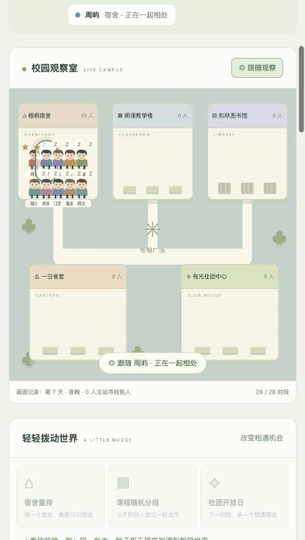

# VirtualCampus · 赛博校园

> 十个独立的小世界，在同一座校园慢慢交织。

校园背景的半上帝模式微型生命模拟器。观察 10 位 NPC 自主生活与关系故事，通过改变环境影响相遇。**v0.3 使用 Vue 3 + TypeScript + Vite，模拟核心独立、规则可解释、无需大模型 API 密钥。**

NPC 会记住一起吃饭的约定、为小组报告安排专注时间，也可能中断、等待或错过。友情、误解、竞争与心动影响后续选择；玩家改变机会，角色自己决定。



## 本地运行

Node.js 22.12+，建议 Node.js 24 LTS：

```sh
git clone https://github.com/L8848-Li/VirtualCampus.git
cd VirtualCampus
npm ci
npm run dev
```

访问 http://127.0.0.1:8765 。端口被占用时：`npm run dev -- --port 8766`。

构建静态文件：`npm run build`，本机检查构建结果：`npm run preview`。本版需要通过开发服务或静态 HTTP 服务打开，已从双击 HTML 的原型迁移到模块化工程。

## 开始观察

1. 输入种子，新建世界；单步或自动推进七天、每天四时段。
2. 点击角色查看需求、重要记忆和挂在心里的计划；用 ☆ 关注最多三人。
3. 关系图切换 TA 看别人 / 别人看 TA，跟随观察持续高亮一个角色。
4. 重排宿舍、随机分组或举办社团开放日，改变相遇与协作条件。
5. 观察饭约是否兑现、小组报告由谁实际推进；查看经过可追溯规则和前置事件。
6. 每日校园墙归档代表片段，重放验证同版本、种子与干预的一致性。

每次推进与干预自动保存到当前浏览器。导出 / 导入带版本和校验的 JSON 可转移或备份。v0.3 不兼容旧版存档；旧版本机存档使用独立键保留。没有账号或云同步。

## 轻量架构

| 层              | 职责                                                     |
| --------------- | -------------------------------------------------------- |
| Vue 组件        | 地图、人物档案、关系图、共同事务、时间线与弹窗           |
| 控制层          | 接收操作、播放时钟、导入导出、本机存储，发布普通数据快照 |
| TypeScript 内核 | 世界推进、可解释评分、计划状态机、社交、任务和因果事件   |
| 开发与测试      | Vite、vue-tsc、Vitest、多种子行为评估                    |

运行时依赖只有 Vue；未引入额外状态库、路由、后端或游戏引擎。内核不导入 Vue、DOM 或系统时钟。

```text
src/App.vue                 页面组合
src/components/             独立界面组件
src/controller/             操作与快照控制层
src/engine.ts               世界推进、事件、记忆、重放和存档
src/core/decision.ts         效用评分
src/core/plans.ts            承诺、等待、中断与兑现
src/core/tasks.ts            小组事务、进度与截止
src/core/social.ts           邀约、回应、关系与解释
src/core/evaluation.ts       多种子行为指标
scripts/evaluate.ts         生成评估报告
tests/                      模拟与行为回归检查
```

## 验证

```sh
npm run check
npm test
npm run evaluate
npm run build
```

迁移阶段 2,800 个状态与原 JavaScript 内核逐一一致，再独立加入 v0.3 新规则。当前测试覆盖 100 个种子的逐时段重放、状态边界、局部信息、计划持续与中断、共同事务、存档与行为质量。

`npm run evaluate` 默认检查 100 个种子、28,000 次角色行动，生成 [行为评估报告](docs/reports/behavior-v03.json)。指标有明确场景和口径，不能代替实际游玩体验。CI 在 Node.js 22 / 24 运行类型检查、测试、评估和构建。

[架构与算法](docs/ARCHITECTURE.md) · [运行验收](docs/PROTOTYPE.md) · [迁移记录](docs/MIGRATION.md) · [下一轮脑暴](docs/BRAINSTORM-v03.md) · [贡献说明](CONTRIBUTING.md) · [MIT 许可证](LICENSE)
