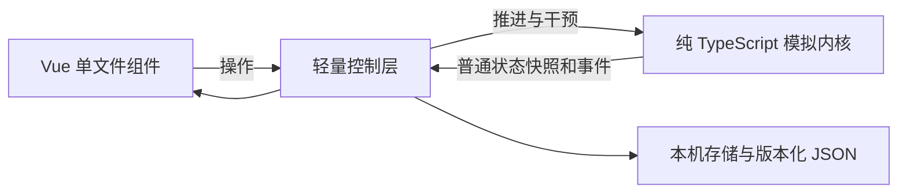

# v0.4 架构与算法

## 分层

Vue 只接收数据快照，不代理 World 实例。界面组件通过事件发出操作；控制层维护播放计时器与选中、关注等显示状态。内核可直接在 Node 中运行，与动画、页面、系统日期和模型服务无关。

运行时只依赖 Vue；Vite、TypeScript、vue-tsc 和 Vitest 用于开发。无额外状态库、路由、后端数据库或游戏引擎。地图保持 DOM / SVG 与浏览器动画，构建后为静态资产。

## 时间与行动

七天、每天四时段。每步依次：需求衰减 → 事务截止与计划检查 → 全员独立选择 → 统一移动与行动效果 → 局部目击 → 报告与活动的实际筹备 → 活动到场与截止结算 → 约定、邀约和同地社交 → 关系、认知和私人经历 → 日终摘要。

效用评分：

`总分 = 需求与目标 + 兴趣习惯 + 承诺加成 - 切换成本 - 回避 - 生理负担 + 种子波动`

基础行动、找熟人、赴约、整理报告和筹备 / 参加兴趣小聚共同参与评分。已接受的计划与活动增加承诺加成，同时保留紧急需求的中断能力。赴约吃饭与解决饥饿兼容，不会被当作妨碍进食的外出。

仍是逐时段的短期决策与小型状态机，不做全局最优规划。并发决策先于统一移动，后执行者不能读取先执行者即将去哪里。

## 小计划

计划阶段为 pending、waiting、working、fulfilled、cancelled、expired。

- 饭约在一次实际正向交流后提出，受邀者按关系与预期社交需求独立接受或拒绝。
- 接受后双方各自记住下一次午间的地点与时间，到了时段才增加赴约候选行动。
- 精力过低或相冲突的迫切需求可以中断。取消只记录在当事人自己的经历中，不向对方通报实时状态。
- 到场者不知道对方在哪里，最多多等一个时段；过期后回到自己的生活。
- 实际没等到人使到场者的信任略微下降，下一次相见可触发当面解释。这个变化只影响亲历的一方。
- 整理报告可成为两个时段的专注计划，允许中断，完成阶段并不等于整份报告完成。

## 共同事务

三个课程小组各有一份校园观察报告，目标进度 26，截止第五天夜晚。普通行动不会凭空增加任务进度；只有选了相应事务、实际在图书馆、且属于当前小组的角色才能贡献。多人同场有协作加成。

任务公开记录成员、实际贡献、进度、截止和开放 / 完成 / 过期状态。课程随机分组更新参与人，保留已完成进度，事件同时连接旧的任务历史与分组干预。报告发布与进度视为课程公共信息。

每个 NPC 仍自主决定是否工作，报告没有保证成功的脚本。关系互动可围绕具体报告分工发生；没有实现第三方谣言网络或任意命题的信念系统。

## 局部信息、记忆与关系

寻找熟人只使用亲眼观察的位置：最近目击有效三时段，同一时段的习惯预测有效八时段。扑空会使线索失效，不直接读取其他角色实时位置。宿舍相遇还要求同室。

亲历记忆最多八条，按重要性减去时间衰减排序。位置缓存独立有界。玩家可看全局事实，角色只能使用自身信息、已接受约定和课程公开事务。

认知与私人原因单独保存，避免被八条近期记忆挤掉。首版认知限于两种具体解释：等不到赴约者、把真实发生的简短回应理解成冷淡。每条认知包含本人经历的来源、置信度、关联事务和证据；私人原因只属于当事人。解释必须在同地交流中实际说出，再由接收者按信任和敏感度更新判断，允许继续怀疑。同一份解释不能反复作为新证据刷取信任，未解问题也不重复扣除关系。

## 人物自主的小活动

一次实际的正向相处可能激发兴趣分享会的愿望。发起人由当时的人物状态和性格产生，一周最多一个项目。活动安排在未来午后，需四点实际准备量，并由发起人和至少一位答应的伙伴自主到场。接受邀请不增加进度，也不保证出席。

邀请只在与发起人实际同地交谈时传达。决策只读取自己收到的邀请、约定时间和自己的准备量，不读取其他人的实时选择。筹备、吃饭、休息、报告与相约都会竞争时间。材料不足、主办人缺席或到场不足会取消；只有现场参与者获得结算记忆和共同经历的关系收益。课程重新分组不会改写活动参与意愿。

## 持续故事与校园手记

`stories.ts` 按饭约、报告、活动和未解的关系问题聚合已提交事件。提议、拒绝、改变安排、等待、误读与之后的解释保持在同一段经过中；事务结束后仍有认知问题，故事会保持待追看状态。人物猜测与世界事实分别展示，阅读不修改世界或消耗随机数。

故事卡支持关注人物和未解事项筛选，详情提供事实、各自理解、后续牵挂和完整经过。校园手记是观察者每日摘要，当前未实现可被 NPC 阅读和转发的校园墙。

好感、信任和心动有方向；误解与失约可能只改变一方。关系、重要经历、已知位置和目标共同影响将来行动。故事仍采用确定性规则模板，不调用大模型。

## 随机与因果

随机性通过种子初始化的 Mulberry32 产生。新认知和活动的随机判断按用途、人物、事件或时刻派生独立键，不消耗通用随机流。动画、播放速度、故事阅读和 Vue 响应式不进入随机序列。

事件保存人物、类型、时段、重要度、数据和前置 ID。父 ID 必须早于子 ID。行动有完整评分分项和目击记录；承诺连接提出、接受、等待、兑现或中断；任务连接实际参与的行动、进度与截止。

这是执行追踪，不是严格的反事实因果证明。原有行动、社交与环境仍共用随机流，干预引发的后续随机序列变化也可能造成世界差异；尚未完成全部随机流拆分或世界分支界面。

## 存档与版本

v0.4 使用 schemaVersion=3、engineVersion=0.4.0：存档格式仍是种子、时段、干预输入和完整状态校验值，规则版本已变化。导入验证输入后重新模拟，不直接信任导入的 NPC 对象。校验用于差错检测，不是密码学签名。

本机保存另含关注、选中、跟随和时间线筛选。恢复后暂停，v0.4 使用 `virtualcampus.save.v4`；旧版存储键保留，暂不提供跨引擎版本迁移。

## 扩展边界

新增行动放在 decision；承诺与持续性放在 plans；共同事务放在 tasks；互动与关系结算放在 social；认知与当面解释放在 cognition；自主活动放在 activities；只读故事整理放在 stories。类型集中在 types，角色配置在 config。修改规则时同步行为测试、版本和评估口径。

十人、五地继续采用有界遍历。大量 NPC、长周期或多人需求出现后，再根据实测考虑空间索引、后台计算、快照与服务端。
