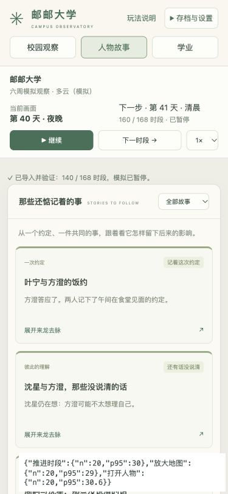

# v0.17 轻量化验证报告

测量日期：2026-10-30。基线是 `b5fa1c1` 的原版 v0.16；本机 macOS arm64、Node 24.16.0。完整玩法、种子散列、随机序列及评分显示精度保留。正式测量和验收结果见下文及同目录原始数据。

## 已完成的调整

- 将每时段从头重放的二次重复模拟，改为两个独立世界同步推进、状态与新增历史比对，加上独立的关键点恢复。
- 合并相同种子、选项、干预和时长的课程、作品与图书馆场景。科研、社团与选课的 30 组学期评估共享一次模拟和恢复；生活实验继续运行 30 对场景。
- 当前状态与事件分离，事件提交后只读；评分以共享名称字典和定宽整数保存，详情按需还原。保存校验只处理新增历史与当前状态。
- 快照共享已提交事件，历史查询使用派生索引。事件、故事、经过分别按 100、6、50 条分页，折叠正文按需创建。
- 常规、监听及完整测试均使用一个工作线程并保留文件隔离。Node 24 完整验证，Node 22 兼容检查；同分支旧任务自动取消。

## 模拟与保存基准

两个独立进程分别运行原版与新版本的同一基准：一次 seed 0 冷启动、一次 seed 1 预热、seed 0 五次重复；每轮 168 时段，依次测推进、快照、保存。表格是每轮 P95 的五轮中位数。期间没有已知项目长测或自动播放，其他系统活动未控制。RSS 是整个测量进程的峰值，不是浏览器堆或系统总内存。

| 指标 | v0.16 | v0.17 | 变化 |
|---|---:|---:|---:|
| 推进 P95 | 0.546 ms | 0.534 ms | 约 -2% |
| 快照 P95 | 0.682 ms | 0.406 ms | 约 -40% |
| 保存校验 P95 | 65.963 ms | 0.612 ms | 约 -99.1% |
| 同步三阶段 P95 | 66.777 ms | 1.526 ms | 约 -97.7% |
| 测量进程峰值 RSS | 395.75 MiB | 233.39 MiB | 约 -41.0% |

seed 0、1、99 的完整历史编码分别由 11.09/10.80/10.98 MB 降为 3.49/3.43/3.50 MB，下降约 68%。当前可变状态约 141–145 KB。三个无干预世界的状态、事件和完整评分另与原版直接对照一致。

以上数字由随附的 [汇总数据](performance/2026-10-30.json) 汇总；逐步原始数据见 [原版](performance/before.jsonl) 与[新版](performance/after.jsonl)。两次测量开始和结束的源码摘要均一致。生产 JavaScript gzip 从 85.34 KB 增至 88.78 KB，新增约 3.44 KB 查询及紧凑存储逻辑。

## 测试与行为

全部原有定向规则要求保留；三项相同的长场景合并为一项多观察者回归。新增行为摘要、评分、增量校验、旧存档保留、保存失败、缓存失效、索引边界和分页追溯检查。

完整测试覆盖 100 个种子 × 生活实验两种模式，保留原干预频率。对 0、1、99 在两种模式分别执行 17 个存档恢复检查点，并续跑至第 168 时段。完整重算校验在完整测试中逐时段执行。

验收包含首周 100 种子指标与原版完全一致、30 组科研/社团/选课及 30 对生活实验的学期评估。课程容量无违规、个人认知来源错误为零、恢复失败为零。

最终常规测试：**167 项全部通过，29.8 秒**。原默认测试为 146 项、48.4 秒。新增的关键点恢复与原版逐时段对照仍有成本，**20 秒常规目标尚未达到**；当前不缩减其场景覆盖。最终完整测试 **361 项全部通过，75.83 秒**，达到 90 秒目标；整套 `npm run verify` **91.76 秒**，达到 120 秒目标。包括类型检查、全部测试、两类行为评估和生产构建。命令输出见 [完整验证记录](performance/verify.txt)和[常规测试记录](performance/default.txt)。公开文本仅替换了本机目录及临时报告路径，数值和测试结果保持原样。

首次 GitHub Node 22 检查中，外卖回归的 12 个学期及存档重建耗时约 6.1 秒，超过 Vitest 默认 5 秒上限；其余 166 项通过。该长场景现单独设置 30 秒超时，保留全部种子、恢复与断言。这个超时用于容纳共享运行器的速度差异，不是性能达标依据；上述验收时间仍仅指本机测量。云端结果见仓库的 [Checks](https://github.com/L8848-Li/VirtualCampus/actions/workflows/ci.yml)。

## 浏览器检查

使用本机 in-app browser、开发服务器 `?perf` 独立存档。初期 0–20 和末期 140–160 各测推进、人物档案、地图放大 20 次；探针统计两次 animation frame 的近似响应，包含调度与界面更新。

| 场景 | 推进 P95 | 人物档案 P95 | 地图放大 P95 |
|---|---:|---:|---:|
| 初期 | 33.4 ms | 27.3 ms | 25.6 ms |
| 末期 | 30.0 ms | 30.6 ms | 29.0 ms |

第 160 时段共 4,903 条事件、243 段故事，实际创建 100 条事件和 6 张卡片；未展开时没有故事正文。确认完整评分表、经过展开、翻页、跨筛选因果定位及恢复原筛选/分页正常，控制台无错误。1280 px 和 375 px 宽度均无横向溢出。初期/末期采样堆峰值约 15.8/27.8 MiB；这是开发环境少量场景的采样值，未进行实体手机或屏幕阅读器验收。

实际开发验证截图（375 px 窄屏，性能浮层仅在 `?perf` 模式出现）：



## 命令与目标

```sh
npm test
npm run test:full
npm run verify
node --experimental-strip-types scripts/benchmark-save.mjs 0
```

整体验证目标 120 秒，完整测试目标 90 秒，常规测试目标 20 秒；以最终实测记录是否达到，不把缩减随机场景或省略恢复检查作为达标方式。Node 24 本机实测，Node 22 兼容流程由 CI 执行。
